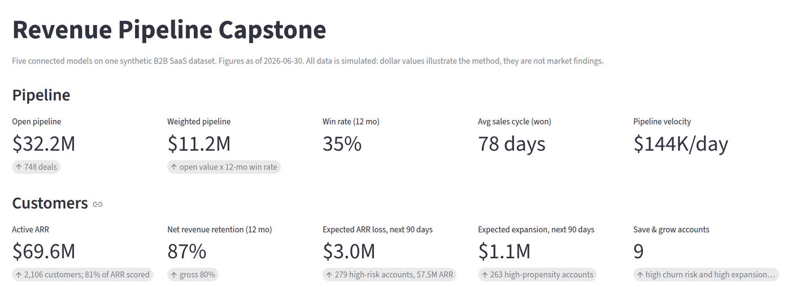
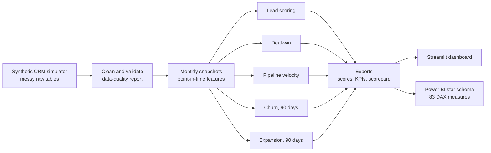
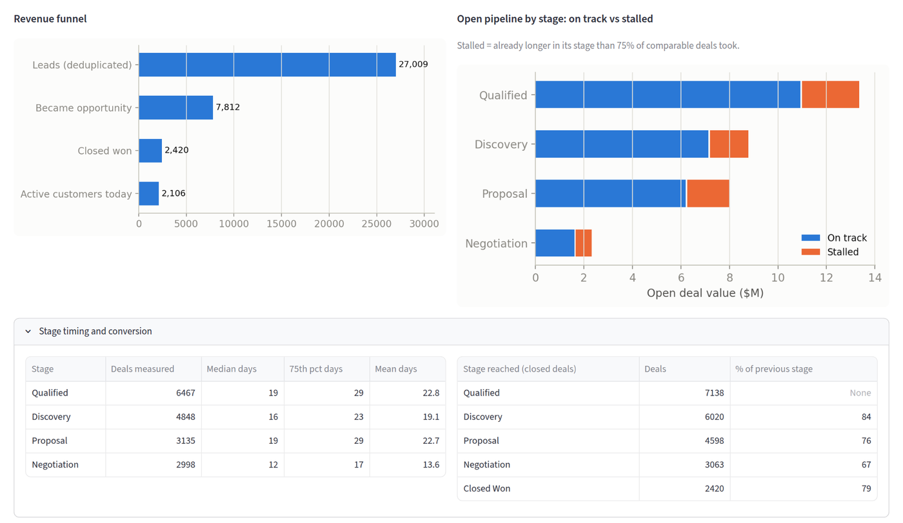
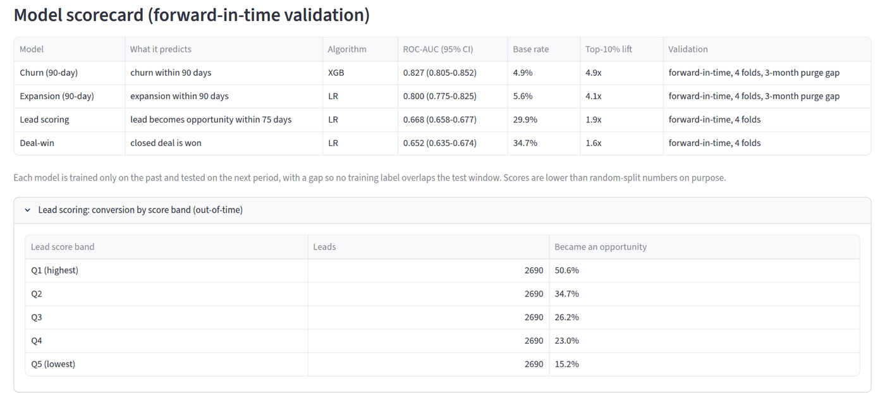
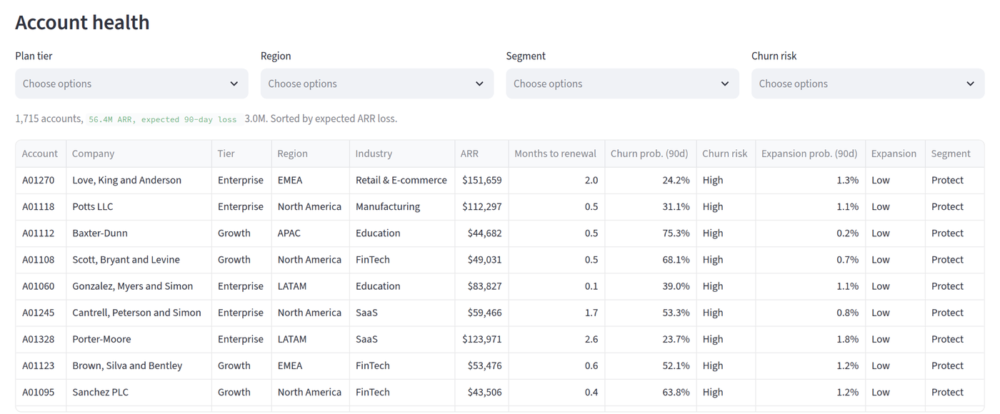
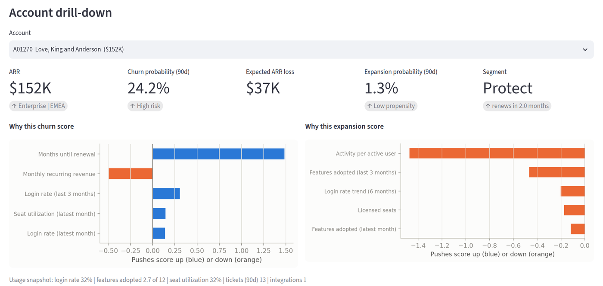
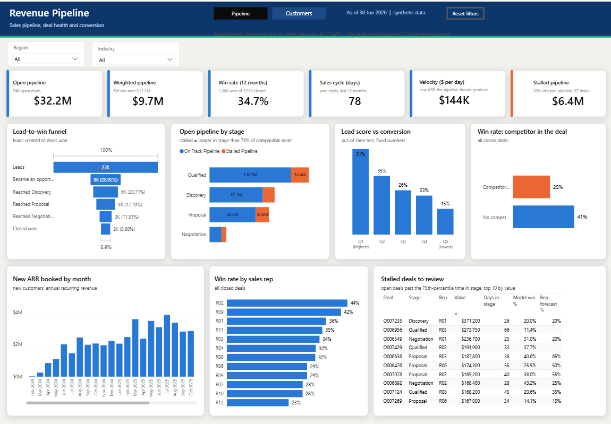
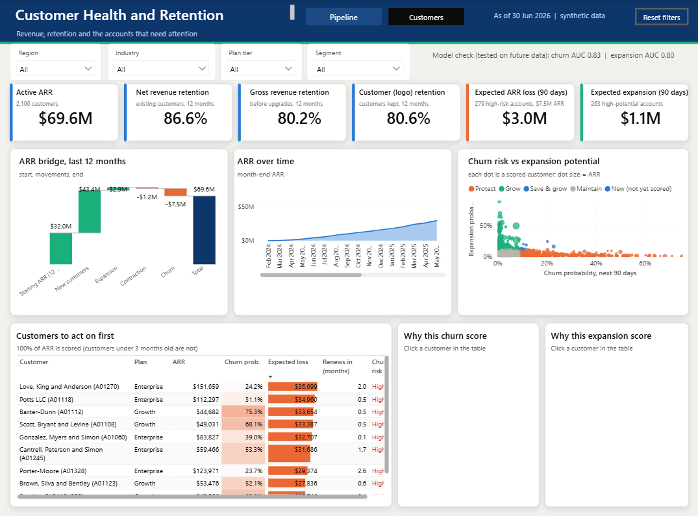
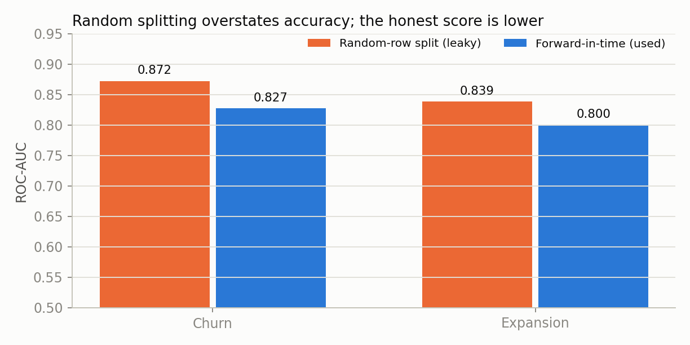
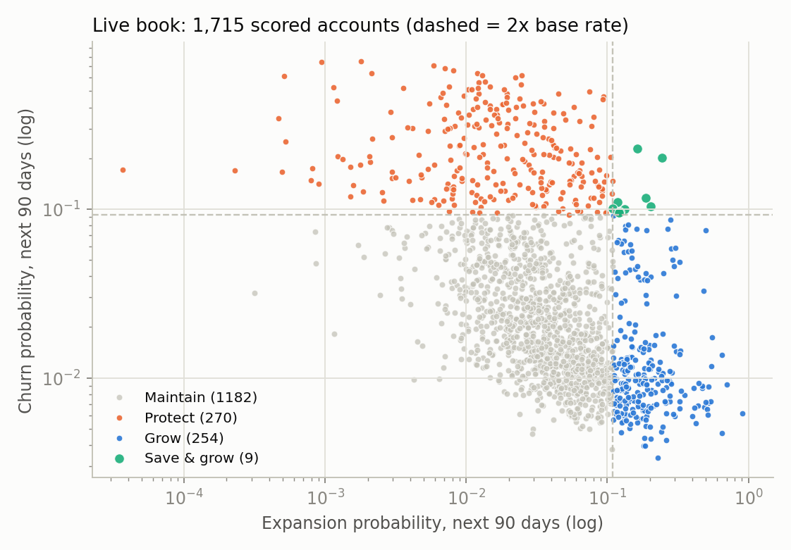

<div align="center">

# Revenue Pipeline Capstone

**Five connected models and two dashboards for one B2B SaaS revenue engine: from first lead to renewal.**

[](https://revenue-pipeline-capstone-avskp88e7hdebnxahry7gu.streamlit.app/)


[**Live dashboard**](https://revenue-pipeline-capstone-avskp88e7hdebnxahry7gu.streamlit.app/) &nbsp;|&nbsp;
[Results](#results) &nbsp;|&nbsp;
[Quick start](#quick-start) &nbsp;|&nbsp;
[Power BI](#power-bi-version) &nbsp;|&nbsp;
[Limitations](#limitations)

</div>



**All data is synthetic.** The simulator is in this repository, its assumptions are in `docs/generator_assumptions.json`,
and every dollar figure below describes that simulated company, not a real market.

## At a glance

| Churn model AUC | Expansion model AUC | Open pipeline | Stalled pipeline | Active ARR | Expected ARR loss, 90 days |
|:---:|:---:|:---:|:---:|:---:|:---:|
| **0.827** | **0.800** | **$32.2M** | **$6.4M** | **$69.6M** | **$3.0M** |

- **Business question:** where is revenue leaking, and which accounts and deals should the team work first?
- **Approach:** lead scoring, deal-win, pipeline velocity, churn and expansion models on one dataset, validated on later periods than they were trained on.
- **Output:** a ranked list of customers by churn risk and expansion potential, a stalled-deal view, and a model scorecard, in Streamlit and Power BI.

## How it fits together



## Quick start

```bash
git clone https://github.com/anvesha2402/revenue-pipeline-capstone.git
cd revenue-pipeline-capstone
./run_all.sh                    # rebuilds data, models, figures, docs (a few minutes)
streamlit run dashboard/app.py  # opens the dashboard on http://localhost:8501
```

To only view the dashboard (the exported files are already in the repository):

```bash
pip install -r requirements.txt
streamlit run dashboard/app.py
```

## Dashboard

The Streamlit app reads only the files in `exports/`. It has pipeline and customer KPI strips, a funnel with stalled-deal view, a model scorecard with validation results, a filterable account health table (churn tier, expansion tier and segment), and an account drill-down with the top drivers for one customer.

| Pipeline and stalled deals | Model scorecard |
|---|---|
|  |  |
| **Account health** | **Account drill-down** |
|  |  |

## Power BI version

`powerbi/` holds a star schema (6 dimensions, 5 facts, 4 reference tables), 83 DAX measures in 7 display folders, a theme, a step-by-step build guide, and a Power BI Project (`.pbip`) generated and schema-checked by `powerbi/check_pbip.py`. Open the `.pbip` in Power BI Desktop and set the `FolderPath` parameter to the folder holding the CSV files.

| Page 1: Pipeline | Page 2: Customers |
|---|---|
|  |  |

## Results

All models are validated **forward in time**: train on the past, test on the next period, with a gap so no training label
overlaps the test window. Intervals are 95% bootstrap intervals that resample whole accounts (or deals).

| Model | Predicts | ROC-AUC (95% CI) | Reference point | What the team does with it |
|---|---|---|---|---|
| Lead scoring | Lead becomes an opportunity within 75 days | 0.668 (0.658-0.677) | Top score band converts 3.3x the bottom band | Reps work leads in score order |
| Deal-win | Closed deal is won | 0.652 (0.635-0.674) | Reps' own forecast alone: 0.643; model + forecast: 0.677 | Managers review competitive, thin-engagement deals |
| Pipeline velocity | Where open deals stall | descriptive | $6.4M of $32.2M open pipeline is stalled | Coaching aimed at specific stages |
| Churn, next 90 days | Account cancels | 0.827 (0.805-0.852) | Renewal date alone: 0.739; top 10% of scores holds 49% of churners | CS contacts high-risk accounts before renewal |
| Expansion, next 90 days | Account buys more | 0.800 (0.775-0.825) | Seat-limit hits alone: 0.687; top 10% of scores holds 41% of expanders | Account managers pitch high-propensity accounts |

Live book on 2026-06-30: 2,106 active customers, $69.6M ARR. The models score customers with at least 3 months of history: 1,715 customers, $56.4M ARR (81% of ARR). The rest joined in the last 3 months and are not scored.
279 accounts ($7.5M ARR) are in the high churn-risk tier. The probability-weighted ARR loss over the next 90 days is
$3.0M. 263 accounts are in the high expansion tier, worth $1.1M of expected expansion ARR over 90 days.
Trailing-12-month net revenue retention is 87% (gross 80%).



## What changed from v1, and why

v1 produced results that did not survive scrutiny. v2 fixes the causes, not the symptoms. v1 numbers are superseded and are not comparable with v2 (different dataset and definitions).

| Problem in v1 | Cause | v2 fix | Evidence |
|---|---|---|---|
| Expansion model scored AUC 1.000 | `features_adopted` was a deterministic function of the account's label | Every observed signal is a noisy reading of a hidden driver; no signal is a formula of the label | Forward AUC 0.800; hidden-driver check below |
| Zero accounts were both churn-risk and expansion-ready | One fixed trajectory per account made the two mutually exclusive | Two hidden drivers per account (health, growth), correlated at 0.25, each able to shift mid-life | 1.3% of out-of-time snapshots sit in the top 20% on both scores vs 4.0% expected if independent; Spearman -0.52 |
| One random train/test split | Rows from the same account and adjacent months landed on both sides | Expanding-window forward validation, 4 folds, 3-month purge gap | Random-row split gives churn AUC 0.872 vs 0.827 forward; expansion 0.839 vs 0.800 |
| Possible use of future information in features | Features were computed over an account's whole life | Monthly snapshots; a feature may only use records dated on or before the snapshot | Point-in-time test passes on 3 snapshot dates: features are identical with future data deleted |
| 473 accounts, 11 flagged | Small simulation | 1,980 accounts with snapshots; 1,715 scored and 2,106 active at the cutoff | Narrower intervals |
| Deal stage used as a feature | For a closed deal, the final stage is the outcome | Only information known when the deal opens | Stage removed |
| No rep forecast | Not in the schema | Rep forecast and discount added; model compared against reps | See deal-win row |
| Risk reported as a flagged-account count | Scores were not calibrated | Probabilities checked out-of-time (calibration slope 0.94 churn, 0.71 expansion) and recalibrated; dollar exposure is probability-weighted | `docs/reliability_*.csv`, `figures/calibration.png` |

## Findings

**Lead scoring.** Leads in the top score band convert at 3.3x the bottom band (95% CI 3.0-3.7). Lead source, contact seniority, engagement score and a demo request carry most of the signal. Logistic regression and XGBoost tie (AUC 0.668 vs 0.667), so the simpler model is deployed.

**Deal-win.** A competitor in the deal cuts the win rate from 41% to 25%. Deal size, rep and decision-makers engaged follow. Reps' forecasts alone reach AUC 0.643, about level with the model (0.652); using both gives 0.677, so each holds information the other lacks.

**Pipeline velocity.** Median days in stage: Qualified 19, Discovery 16, Proposal 19, Negotiation 12. Qualified holds the largest stalled dollar amount ($2.4M) because it holds the most open deals; Negotiation has the highest stalled share (29% of its value). Among deals that reach Proposal, time spent earlier does not change the win rate (54% fastest third, 51% slowest third, each +/-3 points).

**Churn.** Months until renewal is the largest driver, then login rate, seat utilization and feature adoption. Support-ticket volume ranks lower. A logistic model scores 0.748, barely above the renewal-date-only benchmark (0.739); gradient boosting reaches 0.827 by modelling how usage decline interacts with renewal timing.

**Expansion.** Activity per active user, features adopted, integrations connected and the login trend lead. Seat-limit hits alone are a weak signal (0.687).

**Churn and expansion together.** The two scores are negatively correlated (-0.52), and accounts high on both are rare. Across 11,872 out-of-time snapshots, the 155 in the "Save & grow" segment churned at 12% and expanded at 11% within 90 days, versus 16% churn in "Protect" and 17% expansion in "Grow". The live book has 9 such accounts ($213K ARR). The negative correlation is partly built into the simulator (health raises both retention and expansion odds), so treat its size as an assumption.



## Limitations

These are also in `docs/limitations_and_changelog.md`.

1. **Synthetic data.** The models recover relationships the simulator contains. As an internal check, live churn scores correlate 0.68 with the hidden health driver and expansion scores 0.66 with the hidden growth driver. That shows the pipeline works under noise. It does not show the same effects exist in real companies.
2. **Stage timing is an input.** Stage dwell times and where lost deals exit are simulator settings, so the "stalled stage" analysis demonstrates the method, not a market fact.
3. **Overlapping labels.** A churn event appears in up to three consecutive monthly snapshots of the same account. Confidence intervals resample whole accounts to account for this.
4. **Short history.** Thirty months of data, four validation folds; the first fold trains on about ten months.
5. **No causal claims.** SHAP shows what moves a score, not what would change an outcome. Save and expansion plays are untested.
6. **Thresholds are conventions.** Risk tiers use 2x and 1x the historical base rate. Cost-based thresholds need real outreach costs.
7. **Not built yet:** simulated copilot with action plans.

## Repository layout

```
generate_synthetic_data_v2.py   simulator (messy raw tables, fixed seed)
02_clean_and_validate.py        cleaning + docs/data_quality_report.json
03a_build_snapshots.py          point-in-time features, 90-day labels, no-leakage test
03b_lead_deal_velocity.py       lead scoring, deal-win, pipeline velocity
03c_churn_expansion.py          churn + expansion, overlap check, SHAP, calibration
04_export_and_figures.py        dashboard files, scorecard, figures
05_write_docs.py                writes this README and docs/*.md from the results
06_export_powerbi.py            star-schema CSV files for Power BI
rpc_common.py, rpc_features.py  shared validation and feature code
dashboard/app.py                Streamlit app (reads exports/ only)
powerbi/                        build guide, DAX measures, theme, .pbip generator and checks
data/raw, data/clean            messy and cleaned tables
exports/, models/, figures/     dashboard inputs, saved models, charts and screenshots
docs/                           data dictionary, insights, results, limitations
```

## Tools used

| Area | Tools |
|---|---|
| Data and modelling | Python 3.11, NumPy, pandas, SciPy, Faker, scikit-learn, XGBoost, SHAP, joblib |
| Dashboards | Streamlit (Community Cloud), Power BI Desktop, Power Query (M), DAX, TMDL / PBIR |
| Quality checks | Forward-in-time validation, bootstrap intervals, point-in-time leakage test, calibration, `jsonschema` checks on the `.pbip` |
| Delivery | Git, GitHub, Bash (`run_all.sh`) |

Reproducibility: the full pipeline was run twice in clean folders and produced byte-identical data and identical results.
