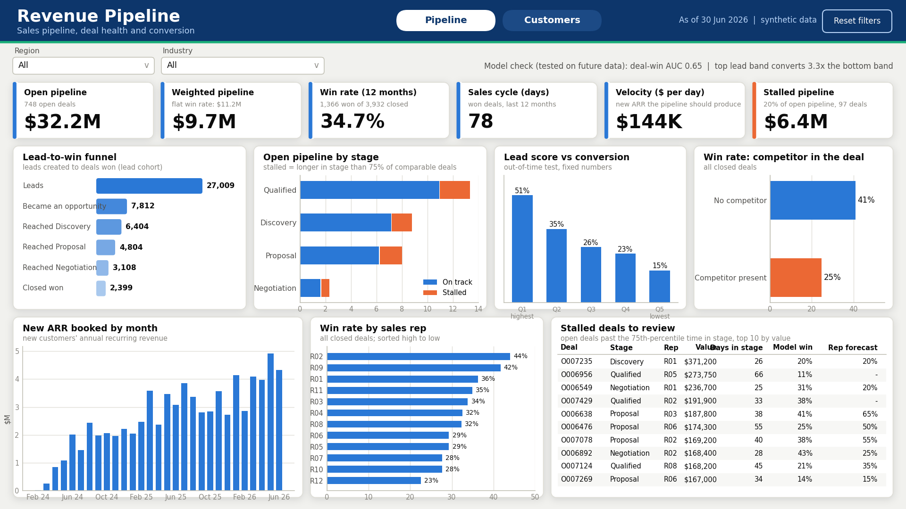
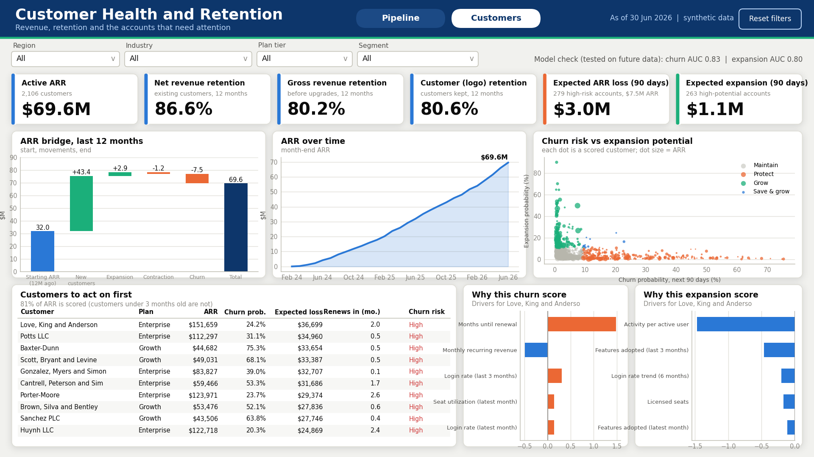

# Build the Revenue Pipeline dashboard in Power BI

A step-by-step guide for someone who has never opened Power BI. Follow the steps in order. Each step says exactly where to click. After every part there is a **checkpoint** with numbers you must see before moving on. If a checkpoint fails, stop and fix it there; do not continue.

**What you will build:** a two-page Power BI report on a proper star-schema data model.

- **Page 1, Pipeline:** open pipeline, weighted pipeline, win rate, sales cycle, velocity, stalled deals, lead funnel, deal stages, win rate by rep and by competitor, and the stalled deals to review.
- **Page 2, Customers:** ARR, net/gross/logo retention, expected revenue loss and expansion, ARR bridge, ARR over time, churn-versus-expansion map, the customers to act on first, and the reasons behind each customer's score.

**What is in the folder you downloaded** (all inside `powerbi/`):

| Folder or file | What it is |
|---|---|
| `data/` | 15 CSV files: the star schema (6 dimension tables, 5 fact tables, 4 small reference tables) |
| `powerquery/` | 15 `.m` files: one loading script per table (you paste them in Part A) |
| `measures.tmdl` | All 83 DAX measures in one file (you paste it in Part C) |
| `measures_plain.md` | The same measures one by one, with plain-language meaning (backup method and glossary) |
| `design/theme_revenue_pipeline.json` | Colours and fonts |
| `design/background_P1_pipeline.png`, `background_P2_customers.png` | The page backgrounds (header band and card panels) |
| `design/preview_page1_pipeline.png`, `preview_page2_customers.png` | What your finished pages should look like |
| `design/layout_map_P1_pipeline.png`, `layout_map_P2_customers.png` | Numbered boxes showing where every visual goes |
| `validation/check_measures.dax` and `expected_values.csv` | A query that prints the model's key numbers, and the correct answers to compare against |
| `Revenue_Pipeline_Power_BI.zip` (separate download) | The finished report as a Power BI Project (`.pbip`). Open it instead of building by hand: see the **Fast path** below |

**Be aware of two things.**

1. I could not open Power BI myself, so I have not seen these exact screens. Every number below was computed independently in Python and matches the Streamlit app, but menu names can differ slightly between Power BI versions. If a menu item is not where I say, type its name into the search box at the top of the Format pane or the Data pane, and Power BI will find it. If something still fails, tell me the step number and the exact message and I will fix the instructions.
2. All data is synthetic. The dashboard says so in the header. Do not present the dollar figures as real market findings.

**Time needed:** about 5 to 7 hours the first time. Suggested sessions: Parts 1 to 4 (about 1.5 hours), Part 5 (about 2 hours), Part 6 (about 1.5 hours), Parts 7 and 8 (about 1 hour).

*The previews are drawn with a different font from Power BI's Segoe UI, so spacing will differ slightly. Colours, positions and numbers will match.*

## Fast path. Open the ready-made project (about 20 minutes)

A second download, `Revenue_Pipeline_Power_BI.zip`, holds the whole report as a **Power BI Project** (a `.pbip` file): the data model, the 14 relationships, all 83 measures, both pages and every visual, slicer and button on them. If it opens, you can skip Parts 2 to 6 and go straight to Part 7 (polish) and Part 8 (test). If it does not open, nothing is lost: Parts 1 to 6 build the same report by hand from the same CSV files.

I could not open Power BI to test it. I checked every file against Microsoft's published formats and cross-checked every field and measure by script, so the most likely problems are small ones (a colour, a label, a filter) rather than a project that fails to load. The `README_FIRST.md` inside the zip lists the nine things to check first.

1. **Unzip** so the folder is `C:\Revenue_Pipeline_Power_BI\`. (The data path inside the project points to `C:\Revenue_Pipeline_Power_BI\data\`. Anywhere else also works; see step 4.)
2. **Double-click `Revenue_Pipeline.pbip`.** Power BI Desktop opens the report. If it says a preview feature is needed: **File > Options and settings > Options > Preview features**, tick *Power BI Project (.pbip) save option*, *Store semantic model using TMDL format* and *Store reports using enhanced metadata format (PBIR)*, click OK, close Power BI and open the file again.
3. **Home > Refresh.** A project stores the design, not the data, so the visuals are empty until you refresh. Loading 15 tables takes about a minute.
4. **If Refresh cannot find a file:** **Home > Transform data > Edit parameters**, set `FolderPath` to your `data` folder (it must end with a backslash), OK, then Refresh.
5. **Check the numbers** against the list in `README_FIRST.md` (for example Open pipeline $32.2M, Active ARR $69.6M). Then go to Part 7.

---

## Part 0. Ten ideas you need (read once, 10 minutes)

1. **Power BI Desktop** is the free Windows program you build in. A finished file ends in `.pbix`.
2. **Power Query** is the loading room. It reads your CSV files, fixes data types and renames columns. You open it with the button *Transform data*.
3. **The data model** is the set of tables and the links between them. You see it in *Model view* (the third icon on the left edge).
4. **Star schema** means the model has two kinds of tables. **Fact tables** hold events you count or add up (one row per deal, per lead, per customer-month). **Dimension tables** hold descriptions you slice by (region, industry, customer, date). Each dimension connects to a fact table by a key. Drawn on paper, the dimension tables sit around the fact table like points of a star. This layout is what business intelligence teams use because it is fast, simple, and stops numbers being counted twice.
5. **Relationship** is the link between a dimension key and a fact key. It is **one-to-many**: one region row to many deals. Filters flow in one direction, from the dimension (the "one" side) down to the fact (the "many" side). When you pick "EMEA" in a region slicer, Power BI hides every fact row that does not belong to EMEA.
6. **Conformed dimension** means one dimension shared by several fact tables. Here, `dim_region` filters deals, leads and customers at once, so one Region slicer controls both pages.
7. **Column vs measure.** A column is stored data (a deal's size). A **measure** is a calculation written in **DAX** that is re-computed every time the filters change (total open pipeline for the regions selected). Rule for this project: put measures in visuals, never drag a raw number column into a visual.
8. **Filter context** is the set of filters in force at any moment: slicers, the row or bar you are looking at, and filters on the visual itself. Every measure answers "what is the number under the current filters?". This single idea explains most of DAX.
9. **Date table.** Time calculations such as "last 12 months" need a complete calendar table marked as the date table. `dim_date` is that table.
10. **Report view** (first icon on the left edge) is where you place visuals on the page. **Table view** (second icon) shows the data. **Model view** (third icon) shows tables and links. **DAX query view** and **TMDL view** (further down the same edge) are where you paste code.

---

## Part 1. Set up (15 minutes)

**Step 1.1 Install or update Power BI Desktop.**
Open the Microsoft Store on your laptop, search *Power BI Desktop*, and install it (or update it if it says Update). Open it. Click **Help > About** and check the version is dated 2025 or later. Older versions may lack TMDL view.

**Step 1.2 Unzip the project.**
Right-click `revenue-pipeline-capstone-v2.zip` > **Extract All**. Open the extracted folder, then `rpc_v2`, then `powerbi`. Keep this folder open; you will return to it often.

**Step 1.3 Copy the path to the data folder.**
Open the `data` folder inside `powerbi`. Click once in the address bar at the top of the File Explorer window (the text turns into a full path). Press **Ctrl+C**. Paste it into Notepad for now. It looks like `C:\Users\Anvesha\Documents\revenue-pipeline-capstone-v2\rpc_v2\powerbi\data`.

**Step 1.4 Start a blank report and save it.**
In Power BI Desktop click **Blank report**. Press **Ctrl+S**. Save as `Revenue_Pipeline_Dashboard.pbix` in the `powerbi` folder. Save often from now on.

**Step 1.5 Switch off two automatic features.**
Click **File > Options and settings > Options**. In the left list, under **CURRENT FILE**, click **Data load**.
- Under *Time intelligence*, **untick** *Auto date/time for new files* (the current-file version).
- Under *Relationships*, **untick** *Autodetect new relationships after data is loaded*.
Click **OK**.
Why: you are supplying your own date table and building the links yourself, so Power BI must not guess.

---

## Part 2. Load the data with Power Query (45 minutes)

**Step 2.1 Open Power Query.**
On the **Home** ribbon click **Transform data** (the button, not the arrow). A new window opens: *Power Query Editor*.

**Step 2.2 Create the folder parameter (once).**
In Power Query Editor, **Home** tab > **Manage parameters** > **New parameter**. Fill in:
- Name: `FolderPath` (exactly, capital F and P)
- Type: **Text**
- Suggested values: **Any value**
- Current value: paste the path from Step 1.3
Click **OK**. A query called `FolderPath` appears in the left list.
Why: every loading script reads this one parameter, so if you move the folder later you change the path in one place.

**Step 2.3 Create the first table query, `dim_date`.**
1. **Home** tab > **New Source** (the arrow) > **Blank Query**. A query named `Query1` appears in the left list.
2. With `Query1` selected, **Home** tab > **Advanced Editor**.
3. A box opens with `let ... in Source` text. Click inside it, press **Ctrl+A**, press **Delete**.
4. In File Explorer open `powerbi\powerquery\dim_date.m` with Notepad. Press **Ctrl+A**, **Ctrl+C**.
5. Go back to the Advanced Editor and press **Ctrl+V**. At the bottom it should say "No syntax errors have been detected". Click **Done**.
6. If a yellow bar says *Please specify how to connect*, click **Edit Credentials**, then **Connect** (accept the default).
7. On the right side, under **Properties > Name**, replace `Query1` with `dim_date` and press **Enter**.
8. You should see a table of dates with columns `Date, Year, Quarter, Year Quarter, Month Number, Month, Month Label, Month Sort, Month Start, Month End, Is Month End`.

**Step 2.4 Repeat for the other 14 tables.**
Do the same six actions (New Source > Blank Query, Advanced Editor, select all and delete, paste the matching `.m` file, Done, rename). The query name **must exactly match** the file name without `.m`. Tick them off:

| # | Query name (and file) | Rows you should see |
|---|---|---|
| 1 | `dim_date` | 912 |
| 2 | `dim_region` | 4 |
| 3 | `dim_industry` | 12 |
| 4 | `dim_rep` | 12 |
| 5 | `dim_stage` | 6 |
| 6 | `dim_account` | 2,420 |
| 7 | `fact_arr_monthly` | 26,170 |
| 8 | `fact_account_health` | 2,106 |
| 9 | `fact_driver` | 17,150 |
| 10 | `fact_opportunity` | 7,886 |
| 11 | `fact_lead` | 27,009 |
| 12 | `ref_model_scorecard` | 4 |
| 13 | `ref_lead_bands` | 5 |
| 14 | `ref_funnel` | 6 |
| 15 | `ref_bridge` | 5 |

(To see a row count, click the query and look at the bottom-left of the window: it shows `N COLUMNS, N ROWS`; for tables over 1,000 rows it may say "Column profiling based on top 1000 rows", which is normal. The real counts appear after Step 2.6.)

**Step 2.5 Check for errors.**
Click each query and scroll through the columns. You must not see any cell that says **Error**. If you do, click on it: the message tells you which column failed. The most common cause is a mistyped query name (a script reads `Folder & "fact_lead.csv"`, so the file must exist in your data folder) or an edited path in `FolderPath`.

**Step 2.6 Load.**
**Home** tab > **Close & Apply**. Power BI loads the tables (about 10 to 30 seconds).

**Step 2.7 Create the measure table.**
Back in the main window, **Home** > **Enter data**. In the window that opens, click the box at the bottom named **Name** and type `_Measures`. Do not type anything into the grid. Click **Load**.
Why: all calculations will live in one tidy table at the top of the field list. The underscore keeps it first alphabetically.

**CHECKPOINT 2.** Click the **Data** pane on the right edge (the list of tables). You should see 16 tables: the 15 above plus `_Measures`. Click the **Table view** icon (second on the left edge), choose `fact_lead` in the Data pane, and confirm the status bar at the bottom says **27,009 rows**. Check two more: `fact_arr_monthly` 26,170 rows and `dim_account` 2,420 rows.

---

## Part 3. Build the star schema (45 minutes)

**Step 3.1 Open Model view.**
Click the third icon on the left edge (it looks like three linked boxes). You will see 16 boxes, one per table, probably scattered.

**Step 3.2 Tidy the layout (optional but recommended).**
Drag the small tables to the top row: `dim_date`, `dim_region`, `dim_industry`, `dim_rep`, `dim_stage`, `dim_account`. Drag the fact tables to a lower row: `fact_arr_monthly`, `fact_account_health`, `fact_driver`, `fact_opportunity`, `fact_lead`. Put the four `ref_` tables and `_Measures` to the far right or bottom. The reference tables stay unconnected on purpose.

**Step 3.3 Create the 14 relationships.**
Click **Home** > **Manage relationships** > **New relationship**. For each row below:
1. Under the first table box choose the **From** table and click its key column so it is highlighted.
2. Under the second table box choose the **To** table and click its column.
3. Set **Cardinality** to *One to many (1:*)*. Set **Cross filter direction** to **Single**. Make sure **Make this relationship active** is ticked.
4. Click **Save**.

| # | From (the "one" side) | To (the "many" side) |
|---|---|---|
| 1 | `dim_region[Region Key]` | `dim_account[Region Key]` |
| 2 | `dim_region[Region Key]` | `fact_opportunity[Region Key]` |
| 3 | `dim_region[Region Key]` | `fact_lead[Region Key]` |
| 4 | `dim_industry[Industry Key]` | `dim_account[Industry Key]` |
| 5 | `dim_industry[Industry Key]` | `fact_opportunity[Industry Key]` |
| 6 | `dim_industry[Industry Key]` | `fact_lead[Industry Key]` |
| 7 | `dim_account[Account ID]` | `fact_arr_monthly[Account ID]` |
| 8 | `dim_account[Account ID]` | `fact_account_health[Account ID]` |
| 9 | `dim_account[Account ID]` | `fact_driver[Account ID]` |
| 10 | `dim_date[Date]` | `fact_arr_monthly[Month End Date]` |
| 11 | `dim_date[Date]` | `fact_lead[Created Date]` |
| 12 | `dim_date[Date]` | `fact_opportunity[Created Date]` |
| 13 | `dim_rep[Rep Key]` | `fact_opportunity[Rep Key]` |
| 14 | `dim_stage[Stage Key]` | `fact_opportunity[Stage Key]` |

(You can also drag a column from the dimension box onto the matching column in the fact box; then double-click the line to check cardinality and direction.)

Note that `dim_region` and `dim_industry` connect both to the facts directly (deals and leads) and to `dim_account` (customers). That is what makes one Region slicer work on both pages.

**CHECKPOINT 3.3.** In Model view you should see 14 solid lines (none dashed). On each line, the end touching the dimension shows `1` and the end touching the fact shows `*`. Every arrow (small triangle) points from the dimension to the fact. If a line is dashed it is inactive: double-click it and tick *Make this relationship active*. If Power BI says *many-to-many*, you picked the wrong columns; delete the line and redo it.

**Step 3.4 Mark the date table.**
Switch to Table view (second icon). In the Data pane click `dim_date`. On the **Table tools** ribbon click **Mark as date table**, choose **Date** as the date column, and click **OK**.

**Step 3.5 Set the sort order of text columns.**
Text such as month names sorts alphabetically (Apr, Aug, Dec...) unless you give it a sort helper. In Table view, click the column in the Data pane, then on the **Column tools** ribbon click **Sort by column** and choose the helper:

| Table | Click this column | Sort by |
|---|---|---|
| `dim_date` | `Month Label` | `Month Sort` |
| `dim_date` | `Month` | `Month Number` |
| `dim_stage` | `Stage` | `Stage Order` |
| `dim_account` | `Plan Tier` | `Plan Tier Order` |
| `dim_account` | `Segment` | `Segment Order` |
| `ref_funnel` | `Step` | `Step Order` |
| `ref_bridge` | `Step` | `Step Order` |
| `ref_lead_bands` | `Score Band` | `Band Order` |

**Step 3.6 Hide the plumbing.**
Fields that exist only to link or sort should not appear to report users. In Table view, click a table, **Ctrl+click** the columns listed, right-click one of them, choose **Hide in report view**.

| Table | Hide these columns |
|---|---|
| every `dim_` table | all `... Key` columns and all `... Order` / `... Sort` / `Month Number` columns |
| `fact_arr_monthly` | `Account ID`, `Month End Date`, `ARR End`, `New ARR`, `Expansion ARR`, `Contraction ARR`, `Churn ARR` |
| `fact_account_health` | every column (you will use measures built on them) |
| `fact_driver` | `Account ID`, `Rank`, `Impact` (keep `Model`, `Driver`, `Direction` visible: you need them for the driver charts) |
| `fact_opportunity` | all `... Key` columns, `Deal Size`, `Discount Pct`, `Decision Makers Engaged`, `Rep Forecast Pct`, `Days in Stage`, `Stage 75th Pctl Days`, `Sales Cycle Days`, `Model Win Probability`, `Deal Label`. Keep `Opportunity ID`, `Outcome`, `Is Stalled`, `Competitor`, `Loss Reason`, `Created Date`, `Closed Date` visible |
| `fact_lead` | all `... Key` columns and the five funnel flag columns (`Became Opportunity` ... `Closed Won`) |
| `_Measures` | `Column1` |

**Step 3.7 Save.** Press **Ctrl+S**.

---

## Part 4. Add the DAX measures (30 minutes)

You will paste all 83 measures in one go using **TMDL view**.

**Step 4.1 Open TMDL view.**
On the left edge, click the **TMDL view** icon (it looks like angle brackets `</>`). If you cannot see it, hover the left-edge icons to read their names. If it is missing entirely, go to Step 4.5 (manual method).

**Step 4.2 Paste the measures.**
Open `powerbi\measures.tmdl` in Notepad. **Ctrl+A**, **Ctrl+C**. Click inside the TMDL view editor. **Ctrl+A** (in case anything is there), **Ctrl+V**.
The first lines should read `createOrReplace`, then `ref table _Measures`.

**Step 4.3 Apply.**
Click **Apply** at the top of the editor. A green message says the changes were applied. If a red message appears, click **Show details** and read the Output pane (see Step 4.6).

**Step 4.4 Check the field list.**
Switch to Report view (first icon). In the Data pane open `_Measures`. You should see seven folders: *0 Helpers, 1 Pipeline, 2 Funnel, 3 Revenue and retention, 4 Risk and growth, 5 Model reliability, 6 Labels and colours*, holding 83 measures.

**Step 4.5 Manual method (only if TMDL view fails).**
Open `measures_plain.md`. For each measure: click `_Measures` in the Data pane, click **Home > New measure**, delete what is in the formula bar, paste the block (it starts with the measure name, a space and `=`), and press **Enter**. Then, with the measure selected, set the **Format** on the Measure tools ribbon as shown above each block (for example Currency, 0 decimals). It is slower (about an hour) but gives the same result.

**Step 4.6 If Apply shows an error.**
- *"Table '_Measures' not found"*: you skipped Step 2.7. Create it, then re-apply.
- *"Cannot find column/measure ..."* naming a table: a table or column name in your model differs from the guide. Open that table, compare the name to the Part 2 and 3 lists, and rename the column to match (right-click a column > Rename), then apply again.
- Indentation or parsing error: re-copy the whole file; do not edit it in Word, which can change tabs and quotes.

**Step 4.7 Test the model before you build any chart.**
Click the **DAX query view** icon on the left edge (it looks like a small table with a play symbol). Open `validation\check_measures.dax` in Notepad, copy everything, paste into the query editor, press **Run**. A one-row result appears at the bottom. Compare it with the answers below.

**CHECKPOINT 4.** Your one-row result must match (small rounding differences in the last digits are fine):

| Measure | Correct value |
|---|---|
| Open Pipeline | 32,229,150 |
| Open Deals | 748 |
| Win Rate 12M | 0.3474 |
| Avg Sales Cycle Days | 77.62 |
| Pipeline Velocity per Day | 144,247 |
| Weighted Pipeline Flat | 11,196,597 |
| Weighted Pipeline Model | 9,707,698 |
| Stalled Pipeline | 6,361,200 |
| Leads | 27,009 |
| Closed Won Leads | 2,399 |
| ARR | 69,618,594 |
| Customers | 2,106 |
| ARR 12M Ago | 31,963,851 |
| New ARR 12M | 43,449,775 |
| Expansion ARR 12M | 2,910,326 |
| Contraction ARR 12M | -1,174,923 |
| Churned ARR 12M | -7,530,434 |
| Net Revenue Retention 12M | 0.8656 |
| Gross Revenue Retention 12M | 0.8022 |
| Logo Retention 12M | 0.8057 |
| Expected ARR Loss 90D | 2,990,422 |
| Expected Expansion 90D | 1,134,435 |
| Scored ARR | 56,393,285 |
| High Churn Risk Accounts | 279 |
| Churn Model AUC | 0.8274 |
| Lead Score Lift | 3.33 |

If every number matches, the model and the measures are correct. If one is wrong, see the troubleshooting table in Part 9 before building anything.

Press **Ctrl+S**.

---

## Part 5. Page 1: Pipeline (about 2 hours)

### 5.0 Page setup (once per page)

**Step 5.0.1 Import the theme.**
Report view. **View** ribbon > **Themes** (the small arrow) > **Browse for themes**. Select `design\theme_revenue_pipeline.json`. A message says the theme was imported. The theme sets the colour order (blue, orange, aqua...), Segoe UI fonts, and makes visual backgrounds transparent so the page background shows through.

**Step 5.0.2 Name the page.**
Double-click the tab *Page 1* at the bottom, type `Pipeline`, Enter.

**Step 5.0.3 Canvas size.**
Click an empty part of the page. In the **Visualizations** pane, click the paint-roller icon (**Format page**). Open **Canvas settings** and make sure *Type* is **16:9** (1280 x 720). If it says Custom, set Width 1280, Height 720.

**Step 5.0.4 Background image.**
Still in **Format page**, open **Canvas background**. Click **Browse**, choose `design\background_P1_pipeline.png`. Set **Image fit** to **Fit** and **Transparency** to **0%**. Open **Wallpaper** and set the colour to `#F1F1EE` (hex code box at the bottom of the colour picker), transparency **0%**.
You now see the navy header band and blank white cards. Every visual you add will sit inside one of these cards.

**Step 5.0.5 Fit the page.**
**View** ribbon > **Page view** > **Fit to page**.

**How to place any visual exactly (you will do this about 30 times).**
Select the visual. In the **Visualizations** pane click **Format visual**, then the **General** tab, open **Properties**. Type values into **Horizontal position**, **Vertical position**, **Width** and **Height**. The numbers in this guide are in pixels on the 1280 x 720 canvas. The numbered boxes in `layout_map_P1_pipeline.png` show the same positions.

**How to add a visual.**
Click an empty part of the page (nothing selected), then click a visual icon in the **Visualizations** pane. A blank visual appears. Drag fields from the **Data** pane into the boxes under the icons (the "field wells"). To change a measure's number format or the label, use **Format visual**.

### 5.1 Header

**Step 5.1.1 Title.**
**Insert** ribbon > **Text box**. Type `Revenue Pipeline`. Select the text, then in the small toolbar set Font `Segoe UI Semibold`, size 20, colour white. Position: Horizontal 24, Vertical 6, Width 420, Height 32. With the text box selected, **Format > General > Effects > Background** off.

**Step 5.1.2 Subtitle.**
Another text box: `Sales pipeline, deal health and conversion`. Segoe UI, size 10, colour `#B7D3F6`. Position: Horizontal 24, Vertical 34, Width 420, Height 20. Background off.

**Step 5.1.3 Page navigator.**
**Insert** > **Buttons** > **Navigator** > **Page navigator**. Position: Horizontal 560, Vertical 14, Width 290, Height 32. In **Format**:
- **Style** > *Shape*: rounded, 16.
- **State: Default**: Fill `#1C4A85`, text colour white, size 11, border off.
- **State: Selected**: Fill white, text colour `#0D366B`, bold.
It shows one button per page; you will have `Pipeline` and `Customers` when Page 2 exists.

**Step 5.1.4 As-of label.**
Click empty page, click the **Card** visual icon (not "Multi-row card"). Drag measure `As Of Label` (folder *6 Labels and colours*) into **Fields**. Position: Horizontal 858, Vertical 14, Width 296, Height 32. Format: **Callout value** size 10, colour `#B7D3F6`, alignment right (type *Alignment* into the Format search if you cannot find it); turn **Label** (the small caption under the number) **off**. Title off.

**Step 5.1.5 Reset button.**
**Insert** > **Buttons** > **Clear all slicers**. Position: Horizontal 1162, Vertical 14, Width 98, Height 32. Format: **Style** > Text: `Reset filters`, size 10, colour white; Border on, colour `#B7D3F6`; Fill off.

### 5.2 Slicers (filters)

**Step 5.2.1 Region slicer.**
Click empty page, click the **Slicer** icon. Drag `dim_region[Region]` into **Field**. Position: Horizontal 18, Vertical 64, Width 200, Height 44.
**Format visual > Visual**:
- **Slicer settings > Options > Style**: **Dropdown**.
- **Slicer header**: on, text `Region`, size 9, colour `#52514e`.
- **Values**: size 10.
- Turn **Single select** off (so several regions can be ticked) and **Show "Select all" option** on.

**Step 5.2.2 Industry slicer.**
Copy the Region slicer (select, **Ctrl+C**, **Ctrl+V**), then drag `dim_industry[Industry]` onto the **Field** well and remove `Region`. Change the header text to `Industry`. Position: Horizontal 228, Vertical 64, Width 230, Height 44.

**Step 5.2.3 Model note.**
Add a **Card**. Field: measure `Reliability Pipeline`. Position: Horizontal 470, Vertical 64, Width 792, Height 44. Callout value size 10, colour `#52514e`, alignment right, Label off.
This line tells viewers how far to trust the predictions: it states the tested accuracy of the deal-win and lead-scoring models.

### 5.3 The six KPI cards

**Step 5.3.1 Build KPI 1, Open pipeline.**
Add a **Card**. Drag measure `Open Pipeline` (folder *1 Pipeline*) into **Fields**. Position: @@P1:K1@@
**Format visual > Visual**:
- **Callout value**: font Segoe UI Semibold, size 22, colour `#0b0b0b`, **Display units** = Millions, **Value decimal places** = 1. Result: `$32.2M`.
- **Label** (caption under the number): off.
**Format visual > General**:
- **Title**: on; text `Open pipeline`; font Segoe UI Semibold, size 10; alignment left.
- **Subtitle** (inside the Title area): on; click the **fx** button next to the *Text* box; set **Format style** to *Field value*; under *What field should we base this on?* choose measure `Label Open Pipeline`; click **OK**. Size 8, colour `#898781`.
- Background off (the theme already does this).

**Step 5.3.2 Copy it five times.**
Select KPI 1, **Ctrl+C**, **Ctrl+V**. For each copy: set the position, replace the measure, change the title text, change the subtitle's fx field, and adjust display units.

| KPI | Position | Measure in Fields | Title text | Subtitle field (fx) | Display units / decimals |
|---|---|---|---|---|---|
| K1 | @@P1:K1@@ | `Open Pipeline` | Open pipeline | `Label Open Pipeline` | Millions / 1 |
| K2 | @@P1:K2@@ | `Weighted Pipeline Model` | Weighted pipeline | `Label Weighted Pipeline` | Millions / 1 |
| K3 | @@P1:K3@@ | `Win Rate 12M` | Win rate (12 months) | `Label Win Rate` | None / 1 |
| K4 | @@P1:K4@@ | `Avg Sales Cycle Days` | Sales cycle (days) | `Label Cycle` | None / 0 |
| K5 | @@P1:K5@@ | `Pipeline Velocity per Day` | Velocity ($ per day) | `Label Velocity` | Thousands / 0 |
| K6 | @@P1:K6@@ | `Stalled Pipeline` | Stalled pipeline | `Label Stalled` | Millions / 1 |

To swap the measure on a copy: in the **Fields** well click the **X** next to the old measure, then drag the new one in.

**CHECKPOINT 5.3.** The six cards must show: **$32.2M**, **$9.7M**, **34.7%**, **78**, **$144K**, **$6.4M**. Subtitles read `748 open deals`, `flat win rate: $11.2M`, `1,366 won of 3,932 closed`, `won deals, last 12 months`, `new ARR the pipeline should produce`, `20% of open pipeline, 97 deals`.

### 5.4 Row of four charts (y = 206)

**Visual V1. Lead-to-win funnel**
- Click empty page, choose the **Funnel** icon. Position: @@P1:V1@@
- **Category**: `ref_funnel[Step]`. **Values**: measure `Funnel Value`.
- Format: **Title** on, text `Lead-to-win funnel`; **Subtitle** on, text `leads created to deals won`. **Data labels** on, label contents *Data value, percent of first*. Funnel colour: first theme colour (blue). **Conversion rate** on if offered.
- Check: six bars read 27,009 / 7,812 / 6,404 / 4,804 / 3,108 / 2,399.
- Note: this is a lead cohort. Recent leads have not had time to convert, so the later months pull the percentages down.

**Visual V2. Open pipeline by stage**
- Choose **Stacked bar chart**. Position: @@P1:V2@@
- **Y-axis**: `dim_stage[Stage]`. **X-axis**: measures `On Track Pipeline` then `Stalled Pipeline`.
- In the **Filters** pane (on the right, click the filter icon if hidden) drag `dim_stage[Stage Group]` into *Filters on this visual*, choose **Basic filtering**, tick **Open**.
- Sort: click the **...** at the top right of the visual > **Sort axis** > `Stage` and **Sort ascending**. Qualified is at the top, Negotiation at the bottom.
- **Format**: Title `Open pipeline by stage`; Subtitle `stalled = longer in stage than 75% of comparable deals`. **Bars > Colors**: `On Track Pipeline` blue (`#2a78d6`), `Stalled Pipeline` orange (`#eb6834`). **Legend** on, position top. **Data labels** on, Display units Millions, 1 decimal. **X-axis**: title off. **Y-axis**: title off.

**Visual V3. Lead score vs conversion**
- Choose **Clustered column chart**. Position: @@P1:V3@@
- **X-axis**: `ref_lead_bands[Score Band]`. **Y-axis**: measure `Conversion by Score Band`.
- Format: Title `Lead score vs conversion`; Subtitle `out-of-time test, fixed numbers`. **Data labels** on (0 decimals as a percentage). **Y-axis**: off (the labels carry the numbers). Colour blue.
- Check: five bars, 51%, 35%, 26%, 23%, 15% from left to right (highest score band first).

**Visual V4. Win rate: competitor in the deal**
- Choose **Stacked bar chart**. Position: @@P1:V4@@
- **Y-axis**: `fact_opportunity[Competitor]`. **X-axis**: measure `Win Rate All Closed`. **Legend**: `fact_opportunity[Competitor]` (the same field again; this lets you colour each bar separately).
- Format: Title `Win rate: competitor in the deal`; Subtitle `all closed deals`. **Bars > Colors**: `No competitor` blue, `Competitor present` orange. **Legend** off. **Data labels** on (percent, 0 decimals). **X-axis** range: minimum 0, maximum 0.6.
- Check: No competitor 41%, Competitor present 25%.

### 5.5 Row of three visuals (y = 448)

**Visual V5. New ARR booked by month**
- Choose **Clustered column chart**. Position: @@P1:V5@@
- **X-axis**: `dim_date[Month Label]`. **Y-axis**: measure `New ARR Booked`.
- Format: Title `New ARR booked by month`; Subtitle `new customers' annual recurring revenue`. X-axis labels size 8, **Type** *Categorical*. Y-axis: **Display units** Millions, title off. Colour blue.
- Check: 29 bars from Feb 2024 to Jun 2026; the last bar is about $4.3M.

**Visual V6. Win rate by sales rep**
- Choose **Clustered bar chart**. Position: @@P1:V6@@
- **Y-axis**: `dim_rep[Sales Rep]`. **X-axis**: measure `Win Rate All Closed`.
- Sort: **...** > **Sort axis** > `Win Rate All Closed` > **Sort descending** (best rep on top).
- Format: Title `Win rate by sales rep`; Subtitle `all closed deals`; **Data labels** on; x-axis range 0 to 0.5; colour blue.
- Check: R02 44% at the top, R12 23% at the bottom.

**Visual V7. Stalled deals to review (table)**
- Choose the **Table** icon (grid of rows). Position: @@P1:V7@@
- **Columns**, in this order: `fact_opportunity[Opportunity ID]`, `dim_stage[Stage]`, `dim_rep[Sales Rep]`, then measures `Deal Value`, `Deal Days in Stage`, `Deal Model Probability`, `Deal Rep Forecast`.
- **Filters on this visual** (drag each field to the Filters pane):
  1. `fact_opportunity[Outcome]`: Basic filtering, tick **Open**.
  2. `fact_opportunity[Is Stalled]`: Basic filtering, tick **1**.
  3. `fact_opportunity[Opportunity ID]`: **Top N**, Show items **Top**, **10**, **By value**: drag measure `Stalled Pipeline` into the *By value* box (it is blank for every deal that is not an open, stalled one, so the top 10 are always stalled deals). Click **Apply filter**.
- **Sort**: click the `Deal Value` column header so the arrow points down.
- Format: Title `Stalled deals to review`; Subtitle `open deals past the 75th-percentile time in stage, top 10 by value`. **Grid > Row padding** 3. **Column headers** bold, size 9, **Values** size 9. Rename column headers: click the small arrow on each field in the well > **Rename for this visual**: `Deal`, `Stage`, `Rep`, `Value`, `Days in stage`, `Model win %`, `Rep forecast %`.
- Check: first row O007235, Discovery, R01, $371,200, 26 days, 20%.

### 5.6 Interactions and tests for Page 1

**Step 5.6.1 Stop the rep chart filtering things it should not.**
Select V6 (rep chart). **Format** ribbon > **Edit interactions**. Above every other visual small icons appear (filter, highlight, none). For **K1 to K6** click the **None** icon (circle with a line). Click **Edit interactions** again to leave. (Selecting a rep now filters the stage chart, competitor chart and the stalled-deals table, which are about deals, but does not distort the KPI cards.)

**Step 5.6.2 Test the slicers.**
Set Region to **EMEA** (leave Industry as All) and compare the cards with the first test row in the Part 8 table. Then set Region = APAC and Industry = SaaS and compare with the second row.
Click **Reset filters**. Everything must return to the CHECKPOINT 5.3 values.

**Step 5.6.3 Save.** **Ctrl+S**.

---

## Part 6. Page 2: Customers (about 1.5 hours)

**Step 6.1 Duplicate the page.**
Right-click the **Pipeline** tab > **Duplicate page**. Rename the copy `Customers` (double-click the tab). Duplicating keeps the header, navigator, Region and Industry slicers and the KPI card formatting.

**Step 6.2 Delete what you do not need.**
On the **Customers** page, delete these visuals (click, press Delete): the funnel, stage chart, lead-band chart, competitor chart, new-ARR chart, rep chart and deals table (V1 to V7).

**Step 6.3 Page background.**
Click an empty part of the Customers page > **Format page** > **Canvas background** > **Browse** > choose `design\background_P2_customers.png`. Image fit *Fit*, transparency 0%. Wallpaper `#F1F1EE`.

**Step 6.4 Edit the header.**
- Title text: `Customer Health and Retention`. Subtitle: `Revenue, retention and the accounts that need attention`.
- Slicers: Region now Horizontal 18, Vertical 64, Width 170, Height 44. Industry: Horizontal 196, Width 200.
- Add **Plan tier** slicer: copy Industry slicer, field `dim_account[Plan Tier]`, header `Plan tier`. Position: Horizontal 404, Vertical 64, Width 150, Height 44.
- Add **Segment** slicer: copy again, field `dim_account[Segment]`, header `Segment`. Position: Horizontal 562, Vertical 64, Width 190, Height 44.
- Model note card: replace the measure with `Reliability Customers`. Position: Horizontal 764, Vertical 64, Width 498, Height 44.

**Step 6.5 Keep Region and Industry in step across pages.**
Click the Region slicer. **View** ribbon > **Sync slicers**. In the pane tick both pages under the *Sync* column and the *Visible* column. Repeat for the Industry slicer. Plan tier and Segment stay on this page only (they filter customers, not deals).

**Step 6.6 The six KPI cards.**
Edit each existing card exactly as in Step 5.3.2 (swap the measure, the title text and the subtitle field):

| KPI | Position | Measure | Title text | Subtitle field | Display units / decimals |
|---|---|---|---|---|---|
| K1 | @@P2:K1@@ | `ARR` | Active ARR | `Label ARR` | Millions / 1 |
| K2 | @@P2:K2@@ | `Net Revenue Retention 12M` | Net revenue retention | `Label NRR` | None / 1 |
| K3 | @@P2:K3@@ | `Gross Revenue Retention 12M` | Gross revenue retention | `Label GRR` | None / 1 |
| K4 | @@P2:K4@@ | `Logo Retention 12M` | Customer (logo) retention | `Label Logo` | None / 1 |
| K5 | @@P2:K5@@ | `Expected ARR Loss 90D` | Expected ARR loss (90 days) | `Label Expected Loss` | Millions / 1 |
| K6 | @@P2:K6@@ | `Expected Expansion 90D` | Expected expansion (90 days) | `Label Expected Expansion` | Millions / 1 |

The side accent colours (blue, orange for loss, aqua for expansion) are part of the background image.

**CHECKPOINT 6.6.** The cards read **$69.6M**, **86.6%**, **80.2%**, **80.6%**, **$3.0M**, **$1.1M**. Subtitles: `2,106 customers`, `existing customers, 12 months`, `before upgrades, 12 months`, `customers kept, 12 months`, `279 high-risk accounts, $7.5M ARR`, `263 high-potential accounts`.

### 6.7 Row of three charts (y = 206)

**Visual V1. ARR bridge (waterfall)**
- Choose **Waterfall chart**. Position: @@P2:V1@@
- **Category**: `ref_bridge[Step]`. **Y-axis**: measure `Bridge Value`.
- Format: Title `ARR bridge, last 12 months`; Subtitle `start, movements, end`. **Sentiment colors**: Increase `#1baf7a`, Decrease `#eb6834`, Total `#0d366b`. **Data labels** on, Display units Millions, 1 decimal. Category axis labels size 8.
- Power BI adds the final **Total** bar by itself. Check: Starting 32.0, New customers +43.4, Expansion +2.9, Contraction -1.2, Churn -7.5, Total 69.6. (Starting + movements = Total exactly; the model was built so the bridge always closes.)

**Visual V2. ARR over time**
- Choose **Area chart**. Position: @@P2:V2@@
- **X-axis**: `dim_date[Month Label]`. **Y-axis**: measure `ARR`.
- Format: Title `ARR over time`; Subtitle `month-end ARR`. X-axis labels size 8; Y-axis Display units Millions, title off. Line colour blue, area transparency 80%.
- Check: the line climbs to $69.6M at Jun 2026.

**Visual V3. Churn risk vs expansion potential (scatter)**
- Choose **Scatter chart**. Position: @@P2:V3@@
- **Values**: `dim_account[Account ID]`. **X-axis**: measure `Avg Churn Probability`. **Y-axis**: measure `Avg Expansion Probability`. **Size**: measure `Account ARR Now`. **Legend**: `dim_account[Segment]`. **Tooltips**: add `dim_account[Customer]` and measure `Account ARR Now`.
- Format: Title `Churn risk vs expansion potential`; Subtitle `each dot is a scored customer; dot size = ARR`. **Markers > Colors**: `Maintain` `#B7B6AC` (grey), `Protect` `#EB6834` (orange), `Grow` `#1BAF7A` (aqua), `Save & grow` `#2A78D6` (blue). Marker transparency 30%. **X-axis** and **Y-axis** titles: on, text `Churn probability, next 90 days` and `Expansion probability`; both axes format as percentage, minimum 0. **Legend** on, position top right.
- Customers with no score (new or churned) have no probability, so Power BI leaves them off the chart.
- Check: 1,715 dots; most grey ones cluster bottom-left; orange spreads to the right; aqua sits up the left side.

### 6.8 Bottom row (y = 448)

**Visual V4. Customers to act on first (table)**
- Choose **Table**. Position: @@P2:V4@@
- **Columns**, in order: `dim_account[Customer]`, `dim_account[Plan Tier]`, measure `Account ARR Now`, measure `Avg Churn Probability`, measure `Expected ARR Loss 90D`, measure `Avg Months to Renewal`, `dim_account[Churn Risk]`.
- **Filters on this visual**: `dim_account[Customer]` > **Top N**, Top **10**, By value `Expected ARR Loss 90D`, **Apply filter**.
- Sort: click the `Expected ARR Loss 90D` header so the arrow points down.
- Format: Title `Customers to act on first`; Subtitle: click **fx** > *Field value* > measure `Label Coverage`. Rename headers: `Customer`, `Plan`, `ARR`, `Churn prob.`, `Expected loss`, `Renews in (months)`, `Churn risk`.
- **Conditional formatting** (click the small arrow beside the field name in the Columns well > **Conditional formatting**):
  - `Expected ARR Loss 90D`: **Data bars**, positive bar colour orange `#EB6834`.
  - `Avg Churn Probability`: **Background colour**, Format style *Gradient*, minimum `#FFFFFF`, maximum `#F4B49B`.
  - `Churn Risk`: **Font colour**, Format style *Field value*, based on measure `Churn Risk Color`.
- Check: first row Love, King and Anderson (A01270), Enterprise, $151,659, 24.2%, $36,699, 2.0, High.

**Step 6.8.1 Stop the table from filtering the top row.**
Select V4. **Format** ribbon > **Edit interactions**. Click **None** on K1 to K6, V1, V2 and V3. Leave V5 and V6 on **Filter** (these are the driver charts that react when you click a row). Click **Edit interactions** again to leave.

**Visual V5. Why this churn score**
- Choose **Stacked bar chart**. Position: @@P2:V5@@
- **Y-axis**: `fact_driver[Driver]`. **X-axis**: measure `Driver Impact`. **Legend**: `fact_driver[Direction]`.
- **Filters on this visual**: `fact_driver[Model]` > Basic > tick **Churn**.
- Format: Title `Why this churn score`; **Subtitle**: fx > *Field value* > measure `Driver Hint`. **Bars > Colors**: `Raises the score` orange `#EB6834`, `Lowers the score` blue `#2A78D6`. **Legend** off. Data labels off. X-axis title off.
- Sort: **...** > Sort axis > `Driver Impact` > Sort descending.
- It is blank until you click a customer in the table: this is intended.

**Visual V6. Why this expansion score**
- Copy V5 (Ctrl+C, Ctrl+V). Position: @@P2:V6@@. Change the visual filter from `Churn` to `Expansion`. Title `Why this expansion score`.

**Step 6.9 Test.**
Click the first row in the table (Love, King and Anderson (A01270)). The two driver charts fill: the churn chart should show `Months until renewal` as the biggest orange bar. Click the row again to clear. The KPI cards must not change when you click a row.

**Step 6.10 Save.** **Ctrl+S**.

---

## Part 7. Polish (about 1 hour)

1. **Alt text** (accessibility, and what recruiters notice): select each visual > **Format visual** > **General** > **Alt text**. Write one plain sentence each, for example `Waterfall of ARR from 12 months ago to today`.
2. **Tab order:** **View** ribbon > **Selection pane**. Drag items so the order is title, slicers, KPI cards, charts, table.
3. **Name visuals:** in the Selection pane double-click each name and use the codes `K1`, `V3` and so on. This helps you later.
4. **Filter pane:** collapse the Filters pane (click the arrow) before taking screenshots.
5. **Tooltips:** hover over a bar. Power BI shows the field and value by default; no setup needed.
6. **Check text overflow:** on each KPI card, if the title wraps, lower the font by 1 point.
7. **Check page navigator:** it must show both pages, with the current page highlighted white.

---

## Part 8. Test everything (30 minutes)

Do these tests. They prove the model behaves, which is what an experienced reviewer would try first.

**Test 8.1. Totals.** With no filters, all values equal Checkpoint 5.3 and 6.6.

**Test 8.2. Slicer values.** Set the slicers shown and compare. (Rounding to the figure shown on the card is enough.)

| Setting | Open pipeline | Win rate 12M | Stalled pipeline | Active ARR | Net revenue retention | Expected ARR loss (90D) |
|---|---|---|---|---|---|---|
@@TESTROWS@@

One caution on the *Segment* row: segment is a label as of 30 Jun 2026, and customers who already cancelled carry the segment *Churned*. Filtering to *Protect* therefore removes cancelled customers from the retention maths, so the 95% retention shown for it is flattered. Use the Segment slicer to look at today's book, not to judge retention. The *Plan tier* and *Segment* slicers exist only on Page 2, so the pipeline cards have no values to test for those rows (shown as n/a). Page 2 cards respond to all four slicers.

**Test 8.3. Sync.** Pick `EMEA` on Page 1, switch to Page 2 via the navigator: Region still reads EMEA. Click **Reset filters** to clear.

**Test 8.4. Cross-filter.** On Page 1, click the `Competitor present` bar. The stage chart and the deals table recompute; the funnel does not (leads do not record competitors). Click the bar again to clear.

**Test 8.5. Bridge closes.** On Page 2, mentally add: 32.0 + 43.4 + 2.9 - 1.2 - 7.5 = 69.6. If the Total bar differs, a relationship is wrong.

---

## Part 9. Troubleshooting

| What you see | Likely cause | Fix |
|---|---|---|
| Power Query shows `DataSource.Error: Could not find file` | `FolderPath` is wrong or the file is not in that folder | Home > Manage parameters > Edit parameters; paste the correct path; make sure the CSV names are unchanged |
| A column shows `Error` after paste | Query pasted into the wrong table name | Delete the query; recreate it using the matching `.m` file |
| Measure card shows `(Blank)` | The relationship for that table is missing or inactive | Model view: compare lines with the 14 listed in Step 3.3 |
| Totals are the same however you slice | A relationship is pointing the wrong way or is *both directions* | Double-click the line: Single direction, dimension to fact |
| Month labels sort alphabetically (Apr, Aug) | Step 3.5 was skipped | Select `Month Label` > Sort by column > `Month Sort` |
| Bridge Total bar does not equal ARR | Wrong or duplicate relationship on `fact_arr_monthly` | Check relationships 7 and 10 |
| Funnel shows one bar | `Funnel Value` dropped into Category by mistake | Category = `ref_funnel[Step]`, Values = `Funnel Value` |
| Driver charts are always empty | You have not clicked a customer, or Edit interactions set V4 to None for V5 and V6 | Click a table row; in Edit interactions set V4 to **Filter** for V5 and V6 |
| `A circular dependency was detected` | Two relationships create a loop | Remove any relationship not in the Step 3.3 table |
| Slicer shows `(Blank)` as an option | Normal for a few lead rows with unknown values | Ignore, or untick it |
| `The setting for ... cannot be found` | Different Power BI version | Type the setting name into the Format pane search box |
| TMDL Apply fails | Missing `_Measures` table or edited file | See Step 4.6 |

If something is not on this list, tell me the step number and the exact message.

---

## Part 10. Save, export, share

1. **Save:** `Revenue_Pipeline_Dashboard.pbix` (File > Save).
2. **PDF:** **File > Export > Export to PDF** (exports both pages).
3. **Screenshots:** collapse the Filters pane, use **View > Page view > Fit to page**, then press **Windows + Shift + S** to snip each page. Use these for LinkedIn and your portfolio.
4. **Screen recording:** press **Windows + Alt + R** (Xbox Game Bar) to record a 60-second walkthrough. Show: Page 1 numbers, click a rep, switch to Page 2, click the top at-risk customer, show the drivers.
5. **GitHub:** add the `.pbix` (about 10 MB) to the repository inside a `powerbi/` folder along with this guide, the data folder and the preview images. A `.pbix` can only be opened in Power BI Desktop, so also include the screenshots and PDF in the repository README.
6. **Publishing online:** *Publish to web* needs a Power BI account and an administrator who allows public publishing. A college email often cannot do this. Do not depend on it. Use the PDF, screenshots and video instead.

---

## Part 11. How to talk about this in an interview

Say these in plain words:

- **Star schema:** "Five fact tables and six dimension tables, with Region and Industry shared across deals, leads and customers, so one slicer controls both pages."
- **Date table:** "A marked date table drives all time logic. 'Last 12 months' counts back from the latest date in the data, not today's date, so the report always reproduces."
- **Cohort retention in DAX:** "Net revenue retention takes the customers who paid us 12 months ago and compares their revenue now. It is computed per customer with an iterator, so cancelled customers count as zero. Gross retention caps each customer at their starting revenue."
- **Semi-additive measure:** "ARR is a balance, not a flow, so it cannot be summed across months. The measure takes the last month-end in whatever period is on screen."
- **Disconnected tables:** "The funnel and the ARR bridge use small lookup tables with a measure that picks the right value per row, because those steps come from different columns."
- **Honest modelling:** "Scores come from forward-in-time validated models. The dashboard states the accuracy (churn AUC 0.83, deal-win 0.65) so viewers know how much to trust each score. Customers under three months old are not scored and the dashboard says so."

**Limits to state if asked:** the data is synthetic; the lead and deal-win models are weak (AUC 0.67 and 0.65), so they rank rather than decide; the funnel is a lead cohort, so recent leads have not finished converting; segment, churn risk and expansion tier are as-of-30-Jun-2026 labels, so retention figures under a Segment filter are flattered.

---

## Appendix A. Where each visual goes

@@COORDS@@

## Appendix B. Measure glossary

Open `measures_plain.md` for every measure with its plain-language meaning and formula. The measures used by the visuals are listed in Parts 5 and 6.

## Appendix C. Colours and fonts

| Use | Colour |
|---|---|
| Header band | `#0D366B` (accent line `#1BAF7A`) |
| Page plane | `#F1F1EE` |
| Primary series, on track | `#2A78D6` blue |
| Risk, stalled, competitor present | `#EB6834` orange |
| Growth, expansion | `#1BAF7A` aqua |
| Secondary text | `#52514E` |
| Muted text | `#898781` |
| Font | Segoe UI and Segoe UI Semibold |
